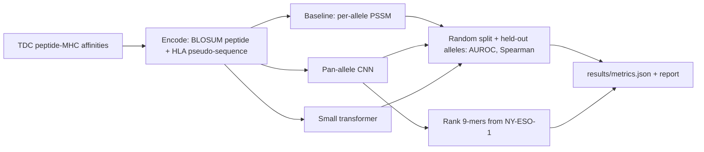

# Pan-allele peptide-MHC class I binding prediction

This project predicts how tightly a short peptide binds an MHC class I protein. It trains a pan-allele CNN and a small transformer on public IEDB affinity measurements (peptide sequence plus the 34-residue MHC pseudo-sequence), compares them with a per-allele position-specific scoring matrix (PSSM), and scores both a random test split and alleles that were never used in training. A last step ranks every 9-mer of NY-ESO-1 for one HLA allele, which is the ranking step in neoantigen shortlisting. These are computational scores on public binding assays, not clinical predictions and not wet-lab measurements.

## Setup

Python 3.12 (3.11 is fine too). From this folder:

```
python -m venv .venv
.venv\Scripts\pip install -r requirements.txt
```

The first line of `requirements.txt` points pip at the PyTorch CPU wheels.

## How to run

```
python run.py
```

That downloads the dataset into `data/` (cached, checksum-checked), builds the splits, trains on CPU, and writes `results/`. Optional flags:

- `python run.py --quick` runs the same steps on 8 alleles and 2 epochs. It is the smoke test and finishes in a few minutes.
- `python run.py --device cpu` is the default. `--device cuda` is accepted when a GPU is present.
- `--results-dir` and `--data-dir` override output and cache locations.
- `--skip-coverage` skips the pytest coverage pass that the full run uses to fill the coverage criterion.

Tests:

```
python -m pytest --cov=src
```

## Architecture



The CNN pools the MHC pseudo-sequence, tiles it onto the peptide, and applies two 1-D convolutions. P2 and the C-terminus are concatenated after pooling because those positions are the usual MHC class I anchors. The transformer reads peptide tokens, then MHC tokens, with positions counted from both ends of the peptide so the C-terminal anchor stays visible when lengths differ. Neither model uses an allele id embedding, so an allele that was held out can still be scored from its pseudo-sequence.

## Design decisions

The published TDC target `Y` is already the NetMHCpan log-transform `1 - log10(IC50 nM) / log10(50000)`. Higher means stronger binding. A binder is `IC50 < 500 nM`, which is `Y` above about 0.426. Models regress that score with mean squared error. AUROC treats the prediction as a ranking score, and Spearman compares it with the measured score. Both point the same direction.

Ten alleles with at least 500 measurements are removed before any random split. The choice is a SHA-256 ranking of `seed:allele` with seed 0, so it does not depend on labels or on NumPy's random stream. The remaining rows are split 80/10/10 inside each allele with seed 0. Stratifying by allele keeps every remaining allele in the training set, which is what a per-allele PSSM needs in order to score the random test. The test split is written once and is not used to pick epochs, learning rates, or which neural model to report. That choice uses validation AUROC only.

The PSSM is fit on training binders only, one matrix per allele and peptide length, with a one-count background pseudocount. If that allele has no binders of the peptide's length, the score falls back to P2 and C-terminal log-odds from the same allele. Alleles absent from training get no score. That is reported on the held-out split instead of a borrowed matrix.

Peptides are BLOSUM62 plus one-hot. MHC pseudo-sequences are BLOSUM62. The 84 peptides longer than 15 residues (out of 185,985) keep their first 14 residues and their C-terminal residue. The model window is 15 so training stays small on CPU.

The file is downloaded with `requests` from Harvard Dataverse file 4167073, which is the file PyTDC requests for `MHC1_IEDB-IMGT_Nielsen`. A direct download avoids PyTDC's larger dependency stack. The cache is accepted only if the SHA-256 and the row count match the published table.

## Limitations

Binding affinity is not immunogenicity, not antigen presentation, and not a clinical neoantigen call. There is no wet-lab validation and no patient data. The random split can place the same peptide in train and test with a different allele, or very similar peptides across the split, so the random-split AUROC is an easier number than the held-out-allele AUROC. AUROC is undefined when an allele has only one class; that allele is omitted from the mean and kept in the per-allele table. The table includes non-human MHC alleles from the Nielsen NetMHCpan collection, not only HLA. Pseudo-sequences are the 34 contact residues used by NetMHCpan, not full HLA proteins. The neural nets are small CPU models. A per-allele PSSM cannot score an allele it did not see; that is a property of the baseline, not a missing file.

## Dataset

Therapeutics Data Commons `MHC1_IEDB-IMGT_Nielsen`: 185,985 peptide-MHC pairs, 43,018 peptides, about 150 MHC class I alleles. License CC BY 4.0. Sources: Nielsen and Andreatta, Genome Medicine 2016; IEDB (Vita et al., Nucleic Acids Research 2019); the TDC release (Huang et al.). Page: https://tdcommons.ai/multi_pred_tasks/peptidemhc/

## Results

Numbers below are written by `python run.py` from `results/metrics.json`.

<!-- RESULTS_START -->
| Criterion | Value | Threshold | Passed |
|---|---:|---:|:---:|
| Binder AUROC (IC50 < 500 nM) on the random test split, best model | 0.939 | >= 0.9 | yes |
| Spearman correlation of predicted vs. measured log affinity, random test split | 0.750 | >= 0.7 | yes |
| Mean per-allele AUROC on held-out alleles | 0.837 | >= 0.8 | yes |
| Best model vs. PSSM baseline | 0.059 | >= 0.03 | yes |
| Test coverage of src/ | 92.811 | >= 75.0 | yes |

| Model | Random-split AUROC | Random-split Spearman | Held-out mean per-allele AUROC |
|---|---:|---:|---:|
| CNN | 0.939 | 0.750 | 0.837 |
| Transformer | 0.887 | 0.651 | 0.737 |
| PSSM baseline | 0.880 | 0.631 | PSSM cannot score unseen alleles |

Best model on validation AUROC: **cnn**.
Runtime: 865.9 seconds.
Peak RSS: 1.103 GB.

The held-out mean is over 9 of 10 alleles. An allele with only one class has no AUROC and stays in the per-allele table.
<!-- RESULTS_END -->

Plots in `results/`: `auroc_comparison.png`, `pred_vs_measured.png`, `learning_curves.png`, `heldout_per_allele_auroc.png`.

Raw files used to recompute the metrics: `results/test_predictions_random.csv`, `results/test_predictions_heldout.csv`, `results/split_summary.json`.
