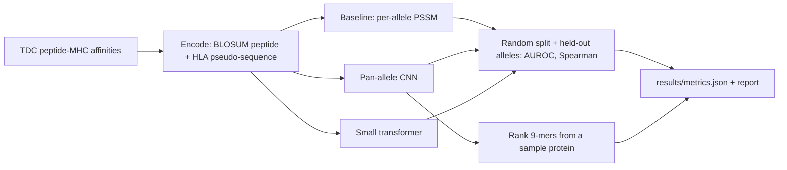

# Pan-Allele Peptide-MHC Class I Binding Prediction - Sequence Deep Learning vs. PSSM Baseline, with Held-Out Alleles

`hla-peptide-binding` · new project · estimated build effort: 5 h

## Problem

Neoantigen vaccine design starts by ranking which tumor peptides a patient's HLA molecules will bind. This project trains a pan-allele deep model (peptide sequence plus HLA pseudo-sequence, CNN and small transformer variants) on public measured binding affinities, compares it with a per-allele position-specific scoring matrix baseline, and evaluates both on a random test split and on alleles never seen in training, then ranks candidate 9-mers from a sample protein to show the neoantigen-ranking use case.

## Target jobs and skills

- **Serova — ML engineer / computational biologist** (`7fbc484f5f54`): covers 81% of the JD's weighted top skills (Python, Deep Learning, PyTorch, Machine Learning, Bioinformatics, Transformers, Model Evaluation, Classification)

Skills/tools this project demonstrates: Python, PyTorch, Deep Learning, Machine Learning, Bioinformatics, Transformers, CNN, Classification, Regression, Model Evaluation

## Data

- **Dataset:** Therapeutics Data Commons MHC1_IEDB-IMGT_Nielsen (IEDB peptide-MHC class I binding affinities) — https://tdcommons.ai/multi_pred_tasks/peptidemhc/
- **License/terms:** CC BY 4.0 (TDC); underlying IEDB data freely available
- **Size used:** ~185,000 peptide-MHC pairs across ~150 HLA alleles (downloaded via PyTDC)
- **Plan:** Two evaluations: (1) a random 80/10/10 split with fixed seed; (2) an allele-held-out split where 10 alleles with >= 500 measurements are removed from training and validation entirely. Affinity is log-transformed; binders are IC50 < 500 nM for AUROC.

## Architecture

## Tech stack

Python 3.11, PyTorch (CPU), PyTDC, NumPy, pandas, scikit-learn, matplotlib, pytest

## Deliverables

- Encoders for peptides (BLOSUM62 + one-hot) and HLA pseudo-sequences
- Per-allele PSSM baseline, pan-allele CNN and small transformer, trained on CPU
- Evaluation on the random split and the allele-held-out split, with per-allele AUROC tables
- Neoantigen-ranking demo that scores all 9-mers of a sample protein for a chosen HLA allele

## Success criteria (all must hold on a from-scratch `python run.py`)

| Metric | Threshold | How it is measured |
|---|---|---|
| Binder AUROC (IC50 < 500 nM) on the random test split, best model | >= 0.90 | test split, scored once |
| Spearman correlation of predicted vs. measured log affinity, random test split | >= 0.70 | test split |
| Mean per-allele AUROC on held-out alleles | >= 0.80 | allele-held-out split |
| Best model vs. PSSM baseline | best model AUROC >= PSSM AUROC + 0.03 on the random split; PSSM cannot score unseen alleles, which is reported | same splits |
| Test coverage of src/ | >= 75% | pytest --cov |

## Evaluation artifacts (required; the evaluator recomputes metrics from these)

- results/test_predictions_random.csv with columns peptide, allele, log_affinity, binder (0/1), model_score, pssm_score
- results/test_predictions_heldout.csv with columns peptide, allele, log_affinity, binder (0/1), model_score
- results/split_summary.json with keys train_alleles, heldout_alleles, n_train, n_val, n_test_random, n_test_heldout

## Baseline

Per-allele position-specific scoring matrix (PSSM) built from training binders.

## Constraints

- Runs on Windows with `python run.py` from a fresh virtualenv; no make, shell scripts, paid APIs, or accounts.
- CPU-only by default (an optional `--device cuda` flag is fine); peak RAM <= 3 GB; total downloads <= 1.5 GB.
- PyTorch (if used) pinned to the CPU wheel via `--extra-index-url https://download.pytorch.org/whl/cpu`.
- Fixed random seeds; every reported number is written by code to results/metrics.json (never typed by hand).
- Test split is created once, saved, and never used for training, tuning, or threshold selection.
- Data download is scripted (Python requests), cached under data/, and verified by checksum or row count.
- Public data only; never claim wet-lab validation, clinical use, or patient data.
- CPU-only training under one hour.

## Draft resume bullets (placeholders are filled only with reproduced metrics)

- Trained a pan-allele peptide-MHC binding model on ~185,000 IEDB measurements, reaching [AUROC] binder AUROC and [SPEARMAN] Spearman vs. [PSSM_AUROC] for a per-allele PSSM baseline
- Generalized to 10 HLA alleles unseen in training with [HELDOUT_AUROC] mean AUROC
- Built a neoantigen-ranking demo that scores every 9-mer of a protein for a patient's HLA allele
